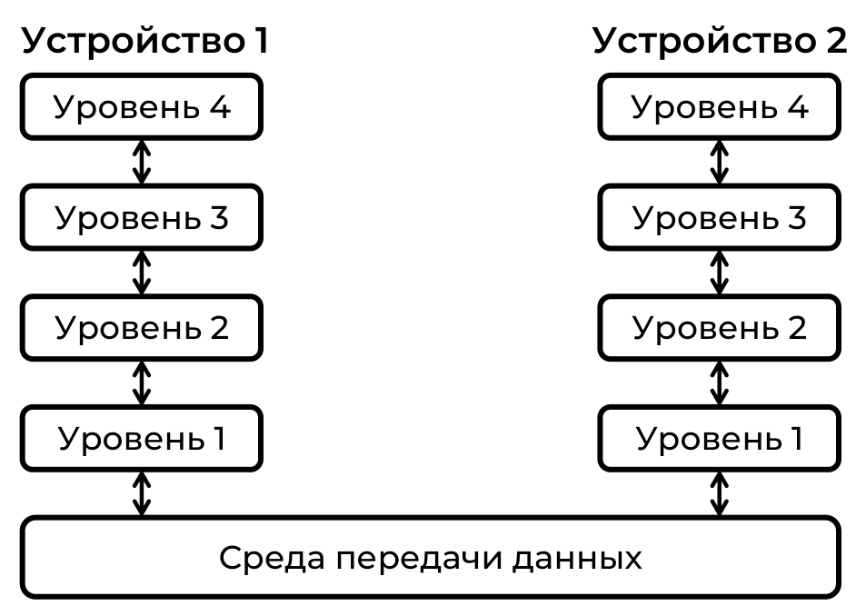
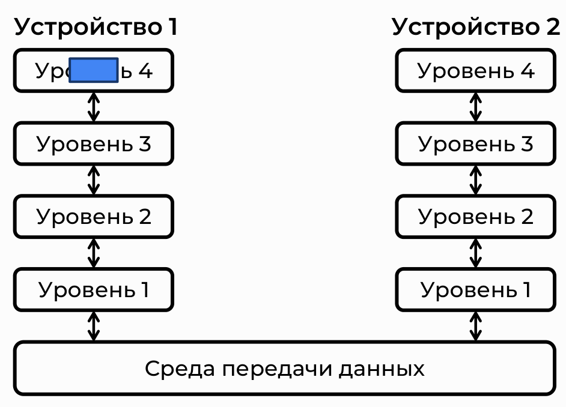

# Организация компьютерных сетей

Андрей Созыкин, курс "Компьютерные сети", лекция 2. [Видео](https://www.youtube.com/watch?v=AzjOIcDyR9M) · [Слайды](https://www.dropbox.com/scl/fi/vwofktqgehat31gf6rtud/01_network_organization.pdf?dl=1&rlkey=zeow1nrm2livxsvcpi8hzql6m)

## Проблемы создания крупной сети

**Главная идея:** крупная сеть должна доставлять данные при сбоях, расти и объединяться с другими сетями. При этом нужно распределять ресурсы, обеспечивать качество обслуживания и безопасность, учитывать расход энергии.

### Надёжность

При передаче данные могут исказиться, сообщение может потеряться целиком, а несколько сообщений могут прийти в другом порядке. В крупной составной сети, например в интернете, между отправителем и получателем бывает несколько путей. Когда часть оборудования выходит из строя или в сети появляются новые узлы, нужно уметь находить рабочий путь.

### Развитие сети

Масштабируемость позволяет сети работать при росте числа устройств. В интернете их несколько миллиардов.

При объединении сетей нужно учесть различия в технологиях. Например, после покупки одной компании другой приходится объединить сети с разными механизмами адресации и допустимыми размерами сообщений. Решение должно позволять подключать новые сети и в будущем.

### Распределение ресурсов

При статическом распределении каждому устройству выделяют фиксированную полосу пропускания, например 10 Мбит/с. Пока устройство не передаёт данные, выделенная ему часть ресурса простаивает. При динамическом распределении пропускную способность получают устройства, которые используют сеть в этот момент.

В лекции рассматриваются две ситуации с перегрузкой.

- Затопление. Отправитель передаёт данные быстрее, чем получатель успевает их обрабатывать. Часть данных в итоге может потеряться.
- Скопление. Несколько устройств передают данные одновременно, и их суммарная скорость превышает пропускную способность сети.

### Качество обслуживания

Требования к задержке и точности передачи зависят от типа нагрузки.

| Что передаём | Требование к задержке | Требование к данным |
| --- | --- | --- |
| Голос или видео в реальном времени | Минимальная задержка | Допустимы небольшие потери, например пропуск нескольких кадров |
| Файл | Задержка допустима | Файл должен передаться без искажений |

В видеозвонке повторная передача потерянных кадров может задержать разговор. При скачивании большого файла можно подождать, чтобы получить его целиком.

### Безопасность

- Перехват информации. Если трафик перехватят, шифрование защитит его содержимое, в том числе пароли и номера банковских карт.
- Поддельный узел. Фальшивый сайт банка может выглядеть как настоящий и получить данные карты, которые вводит пользователь.
- Изменение сообщения. В примере со слайда сумма перевода остаётся 5000 руб., а номер счёта меняется с 1234 на 9876.

### Энергетическая эффективность

Сетевой обмен должен расходовать как можно меньше заряда у устройств с батареей, например телефонов, планшетов и устройств интернета вещей.

## Организация сети в виде уровней

**Главная идея:** сетевое взаимодействие внутри устройства делится на уровни. На схеме у каждого из двух устройств четыре условных уровня. Первый уровень работает со средой передачи данных. Данные могут идти по медному кабелю, оптоволокну или радиоканалу, как в Wi-Fi.

Верхний уровень отправителя получает данные от приложения. Затем данные спускаются по уровням 4 → 3 → 2 → 1, физически переходят на второе устройство через среду передачи данных и поднимаются по уровням 1 → 2 → 3 → 4. С четвёртого уровня получателя данные поступают в его приложение.

## Преимущества уровней

**Декомпозиция.** Задачу построения сети делят на более простые задачи. Каждую из них решает свой уровень.

**Изоляция решений.** Технологию на одном уровне можно заменить, если сохраняется его интерфейс с соседними уровнями. В условной схеме переход с проводной среды на беспроводную затрагивает уровень, который работает со средой. Верхние уровни и приложения продолжают работать через тот же интерфейс.

## Вывод

Уровни делят задачи сети на части и позволяют менять технологии по отдельности. Состав уровней и их назначение описывает эталонная модель сети. Дальше в курсе рассматриваются две такие модели, TCP/IP и OSI (модель взаимодействия открытых систем).
