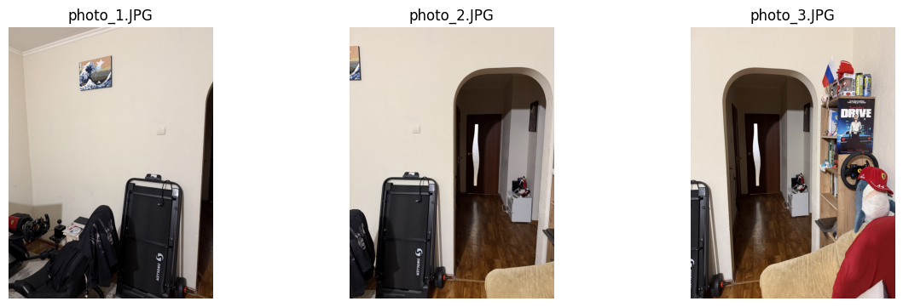
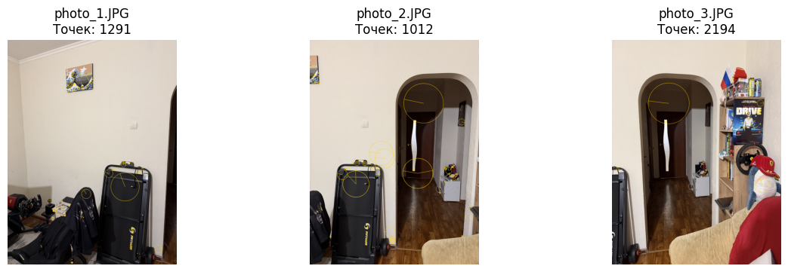
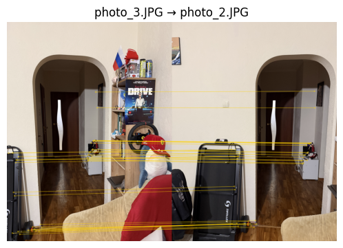
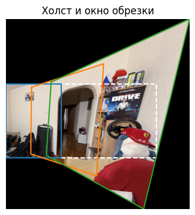
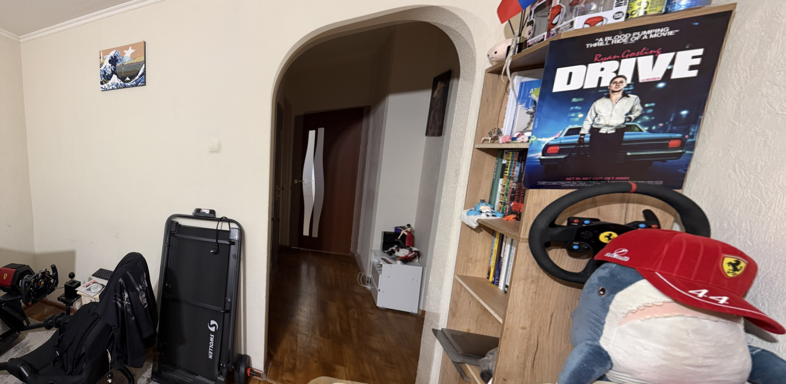

# Лабораторная 6. Построение панорамы

Основной файл `KZ_Lab6.py` открывается в marimo. Версия для Jupyter содержит пояснения к ячейкам и сохранённые результаты. Условие лежит рядом. [Код](../KZ_Lab6.py) · [Ноутбук](KZ_Lab6.ipynb) · [Задание](../task_text.md)

## Карта темы

На трёх снимках видно разные части комнаты. Соседние кадры перекрываются в районе сложенной беговой дорожки и дверного проёма. По общим деталям можно вычислить, куда поставить каждый кадр на общем холсте. В лабораторной 5 мы использовали изменения яркости для выделения границ. Здесь по ним описываем детали и находим их повторно на другом снимке.

Кадры по порядку съёмки → ключевые точки SIFT → критерий Лоу → гомография и RANSAC → координаты первого кадра → склейка → обрезка.

## 1. Съёмка и загрузка кадров

*Задания 1–2. Собираем кадры так, чтобы у каждой соседней пары была общая часть сцены.*

Для панорамы взяли три соседних снимка комнаты. `photo_1.JPG` показывает угол комнаты со сложенной дорожкой. Во втором кадре полностью видна арка. На `photo_3.JPG` видны та же арка и стеллаж справа. В формулах этим файлам соответствуют индексы $0$, $1$ и $2$.

После учёта ориентации JPEG размеры каждого кадра составляют $4284 \times 5712$ пикселей. Перед поиском ключевых точек уменьшаем их до $900 \times 1200$, чтобы ускорить расчёт. Размеры здесь и дальше указаны в порядке "ширина × высота".



Фотографии лежат рядом с `KZ_Lab6.py`. Список `names` задаёт файлы, а `sorted` ставит их в порядок съёмки по номерам в именах. Чтобы загрузка по относительным путям нашла их, выполни команду из папки `Lab6`.

```powershell
marimo edit KZ_Lab6.py
```

Снимки подходят и для ноутбука из папки `explanation`. В marimo панораму можно скачать в PNG под последним рисунком.

## 2. Ключевые точки и дескрипторы SIFT

*Задание 3. Получаем детали, по которым будем искать перекрытие.*

На гладкой стене рядом с аркой мало изменений яркости. У угла сложенной дорожки есть переходы от тёмной рамы к светлой стене в нескольких направлениях. Такой участок проще найти на другом снимке. SIFT ищет устойчивые точки на разных масштабах и описывает каждую по изменениям яркости вокруг неё.

Ключевая точка хранит координаты, масштаб и ориентацию. SIFT делит окрестность на сетку $4 \times 4$ и в каждой из 16 ячеек собирает значения для 8 направлений градиента. Так получается дескриптор из 128 чисел. Знакомый по лабораторной 5 градиент здесь помогает сравнивать фрагменты, снятые с разных ракурсов. [Статья Дэвида Лоу о SIFT](https://doi.org/10.1023/B:VISI.0000029664.99615.94)

В `detectAndCompute` передаём кадр в оттенках серого. SIFT нашёл 1291 точку на первом кадре, 1012 на втором и 2194 на третьем. На третьем снимке появились стеллаж и плакат с мелкими деталями. Для рисунка берём 200 точек с наибольшим откликом на каждом кадре. При сопоставлении используем все найденные точки.



## 3. Критерий Лоу

*Начало задания 4. Оставляем пары, которые выделяются по сходству дескрипторов.*

Возьмём точку на изгибе рамы дорожки в левом краю `photo_3.JPG`. Для её дескриптора в `photo_2.JPG` ближайший кандидат оказался на расстоянии $126.49$, второй на расстоянии $332.91$. Первый кандидат примерно в 2,6 раза ближе, поэтому пара проходит проверку.

Обозначим расстояние до ближайшего кандидата через $d_1$, до второго через $d_2$. В коде проверяем

$$
d_1 < 0.75\,d_2.
$$

Для точки на дорожке получаем $126.49 < 0.75 \cdot 332.91 \approx 249.68$. Если бы расстояния были $120$ и $130$, пара бы отсеялась, потому что $120 > 97.5$. Расстояния в этом шаге относятся к дескрипторам из 128 чисел. Их считает `BFMatcher` с нормой L2, а `knnMatch(..., k=2)` возвращает до двух кандидатов на дескриптор.

## 4. Гомография и RANSAC

*Конец задания 4. Проверяем, можно ли совместить найденные пары одной матрицей.*

Гомография преобразует координаты точки между плоскостями двух кадров. В простом примере точка $(20, 10)$ в следующем кадре видна в предыдущем в $(120, 15)$. Если так сдвигаются все точки, гомография прибавляет $100$ по горизонтали и $5$ по вертикали.

$$
\begin{bmatrix}
1 & 0 & 100\\
0 & 1 & 5\\
0 & 0 & 1
\end{bmatrix}
\begin{bmatrix}20\\10\\1\end{bmatrix}
=
\begin{bmatrix}120\\15\\1\end{bmatrix}.
$$

В общем случае `perspectiveTransform` сначала умножает матрицу $H$ размера $3 \times 3$ на столбец $[x,y,1]^\mathsf{T}$. В полученном столбце $[a,b,c]^\mathsf{T}$ каждый элемент вычисляется по своей строке матрицы.

$$
a=h_{11}x+h_{12}y+h_{13},\qquad
b=h_{21}x+h_{22}y+h_{23},\qquad
c=h_{31}x+h_{32}y+h_{33}.
$$

Координаты на плоскости равны $(a/c,b/c)$. Для точки на раме дорожки из `photo_3.JPG` с координатами $(61.58,707.04)$ матрица даёт примерно $[372.44,693.63,1.002917]^\mathsf{T}$. После деления получаем $(371.36,691.61)$ в `photo_2.JPG`. В примере со сдвигом $c=1$ для каждой точки. Когда $c$ меняется с положением точки, разные части кадра растягиваются по-разному.

Критерий Лоу сравнивает сходство дескрипторов. Похожие углы и края в комнате могут принадлежать разным деталям. RANSAC в `cv2.findHomography` берёт случайные подвыборки из четырёх пар, строит по ним возможные матрицы и проверяет, сколько пар согласуется с каждой матрицей. В работе порог ошибки репроекции равен $3$ пикселям в координатах предыдущего кадра. У точки на раме найденное положение было $(372.31,692.35)$. Расстояние до предсказания $(371.36,691.61)$ составляет примерно $1.21$ пикселя. Эта пара вошла в маску принятых соответствий. [Пример сопоставления и оценки гомографии в OpenCV](https://docs.opencv.org/4.x/d1/de0/tutorial_py_feature_homography.html)

| Преобразование | Пар после Лоу | Пар, принятых RANSAC | Медианная ошибка принятых пар |
| --- | ---: | ---: | ---: |
| `photo_2.JPG` → `photo_1.JPG` | 219 | 135 | 1,19 пикселя |
| `photo_3.JPG` → `photo_2.JPG` | 287 | 146 | 1,07 пикселя |



На рисунке слева стоит следующий кадр, справа предыдущий. В `findHomography` массив `_src` содержит точки следующего кадра, а `_dst` содержит точки предыдущего.

## 5. Перенос в координаты первого кадра

*Задание 5. Вычисляем, где каждый кадр окажется на общем холсте.*

В обозначениях задания $H(0,1)$ переводит точки из `photo_2.JPG` в `photo_1.JPG`, а $H(1,2)$ переводит их из `photo_3.JPG` в `photo_2.JPG`. Для точки на раме дорожки получаем два шага. Из $(61.58,707.04)$ попадаем в $(371.36,691.61)$ во втором кадре. После второго преобразования получаем $(740.68,709.92)$ в координатах первого.

В произведении матриц на столбец первой действует правая матрица.

$$
H(0,1)\bigl(H(1,2)\,p_2\bigr)
=
\bigl(H(0,1)\,H(1,2)\bigr)p_2.
$$

Здесь $p_2=[x,y,1]^\mathsf{T}$ хранит координаты точки в третьем снимке с индексом 2. Если $G_i$ переводит кадр $i$ в координаты первого, то $G_0=I$ и $G_{i+1}=G_i\,H(i,i+1)$. Это вычисляет `transforms[-1] @ _H`. После умножения составной матрицы на точку один раз делим первые две координаты на третью.

У рабочего снимка $900 \times 1200$ крайние координаты $x$ равны $0$ и $899$, а крайние $y$ равны $0$ и $1199$. Из этих значений составляем четыре угла каждого кадра и переводим их в координаты первого. По всем углам берём минимум с округлением вниз и максимум с округлением вверх.

В серии комнаты границы по $x$ получились $0$ и $2997$, по $y$ получились $-1061$ и $2035$. Холст имеет ширину $2997-0+1=2998$ и высоту $2035-(-1061)+1=3097$. Единица учитывает обе крайние координаты. Сдвигаем все кадры на $1061$ пиксель вниз по оси $y$, чтобы верхняя граница холста стала нулём. Выражение `shift @ H` применяет этот сдвиг после переноса кадра.

Четырёх углов достаточно, пока на прямоугольнике кадра знаменатель $c$ сохраняет знак и отличается от нуля. Тогда стороны переходят в конечные отрезки. В исходной серии из шести снимков при переносе четвёртого к первому $c$ менялся от $-0.233$ до $0.639$. Между такими углами он пересекает ноль, а координаты $a/c$ и $b/c$ около этой линии растут по модулю. Конечный холст для целого кадра построить нельзя. Для выбранных трёх снимков у дальнего кадра $c$ лежит примерно между $0.296$ и $0.938$, поэтому перенос углов даёт конечные границы.

## 6. Склейка на холсте

*Задание 6. Преобразуем цветные кадры и смешиваем перекрытия.*

`warpPerspective` переносит каждый цветной кадр на холст. Той же матрицей переносим маску из единиц, используя ближайшего соседа. Ноль на маске означает пустое место. Тёмная рама дорожки находится внутри кадра и сохраняет единицы на маске.

Возле своего края кадр получает меньший вес. Если в одном положении два кадра дали яркости $100$ и $160$ с весами $1$ и $3$, итог будет

$$
\frac{1\cdot100+3\cdot160}{1+3}=145.
$$

Вес берём из `distanceTransform`, который даёт расстояние до ближайшего нуля на маске. Например, на стене около арки вклад второго и третьего кадров меняется по мере приближения к их краям. Для каждого цветового канала делим сумму взвешенных значений на сумму весов. Усреднение сглаживает перепады яркости на перекрытии. Если кадры геометрически расходятся, на границе предмета может остаться двойной контур.

## 7. Обрезка по маске покрытия

*Задание 7. Оставляем прямоугольник, в котором каждый пиксель покрыт хотя бы одним кадром.*

Прямоугольник по крайним ненулевым точкам может захватить пустые углы. Поэтому ищем самый большой по площади прямоугольник, целиком состоящий из единиц маски.

$$
\begin{bmatrix}
0 & 1 & 1 & 0\\
1 & 1 & 1 & 0\\
0 & 1 & 1 & 1
\end{bmatrix}.
$$

Прямоугольник по крайним единицам этой маски содержит $12$ клеток. Самый большой прямоугольник из единиц занимает два средних столбца и все три строки, то есть $6$ клеток.

`largest_covered_rectangle` идёт по строкам сверху вниз. Для каждого столбца хранит длину цепочки единиц, заканчивающейся на текущей строке. В последней строке примера высоты равны $[0,3,3,1]$. Две соседние высоты 3 дают ширину 2 и площадь 6. Стек хранит левые границы полос с возрастающей высотой. Когда справа встречается меньшая высота, прежняя полоса дальше идти не может и её площадь уже можно посчитать. Это позволяет проверить прямоугольники за один проход по маске.



На холсте комнаты белый пунктир ограничивает строки с индексами $1061$–$2260$ и столбцы $0$–$2452$. Верхние и нижние части преобразованных кадров лежат за пределами этого прямоугольника. Внутри него каждый пиксель покрыт хотя бы одной фотографией.

## Как всё складывается

Деталь дорожки в третьем кадре находим во втором по дескриптору. RANSAC принимает эту пару, а произведение гомографий даёт её положение на первом кадре. Тем же преобразованием переносим весь третий снимок, включая стеллаж справа. После смешивания кадров обрезаем холст $2998 \times 3097$ до панорамы $2453 \times 1200$ со стопроцентным покрытием.



На правом краю панорамы стеллаж и плакат растянуты. Для более широкой серии можно перейти к цилиндрической проекции, чтобы уменьшить растяжение вдали от направления первого снимка.

## Что сказать на защите

- SIFT даёт координаты и дескрипторы. Критерий Лоу сравнивает двух кандидатов по дескрипторам. RANSAC проверяет совпадения по геометрии.
- Парная гомография переводит следующий кадр в предыдущий. Произведение матриц переносит произвольный кадр в систему первого.
- Углы задают размеры холста. Маски покрытия позволяют смешать перекрытия и обрезать пустые края, сохранив тёмные области фотографии.

## Проверь себя

**1. Пройдёт ли критерий Лоу точка на раме дорожки при порогах $0.75$ и $0.35$?**

<details>
<summary>Ответ</summary>

Отношение расстояний равно $126.49/332.91 \approx 0.38$. Пара проходит при пороге $0.75$ и отбрасывается при $0.35$.

</details>

**2. Матрица $H(1,2)$ удваивает $x$, а $H(0,1)$ прибавляет $10$. Куда попадёт $x=20$ из кадра 2?**

<details>
<summary>Ответ</summary>

Сначала переносим точку в кадр 1 и получаем $40$. Потом переносим в кадр 0 и получаем $50$. Произведение для столбца записывается как $H(0,1)\,H(1,2)$.

</details>

**3. Почему в серии из шести кадров совпадения соседних пар ещё не гарантируют конечный холст?**

<details>
<summary>Ответ</summary>

Соседние снимки могут хорошо совмещаться попарно. После перемножения матриц дальний кадр переносится на плоскость первого. Если знаменатель преобразования пересекает ноль внутри кадра, его нельзя целиком поместить на конечный холст.

</details>

**4. Что случится, если при обрезке считать любой чёрный пиксель пустым?**

<details>
<summary>Ответ</summary>

Чёрные участки фотографии начнут влиять на границы обрезки как дырки. Нужна маска, которая хранит факт попадания пикселя на холст независимо от его цвета.

</details>
