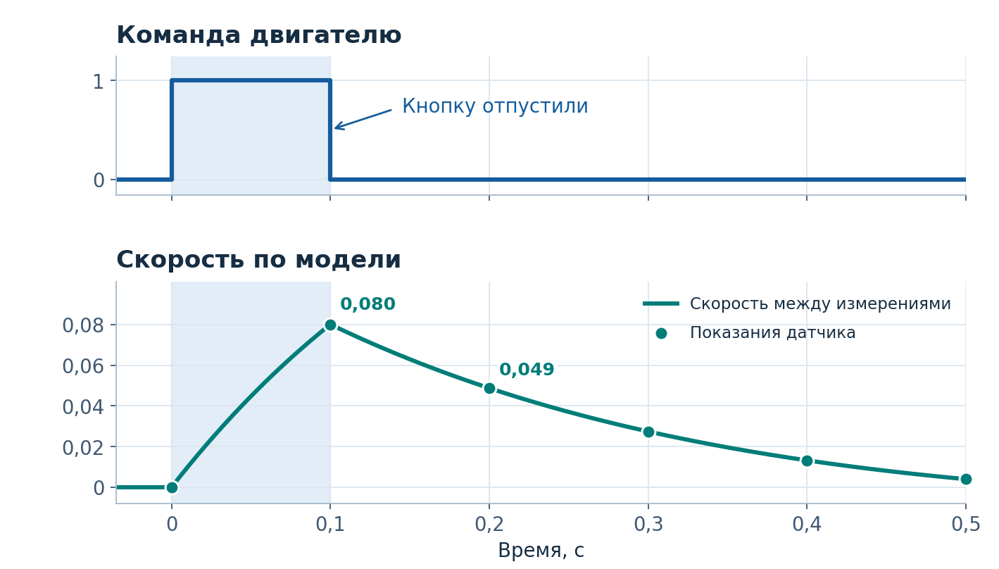
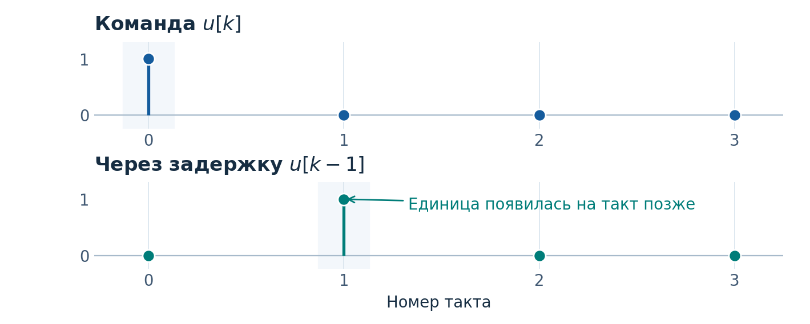
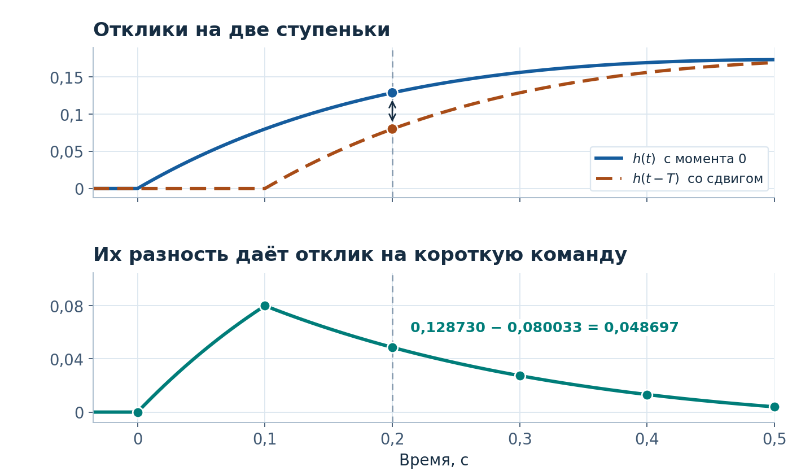
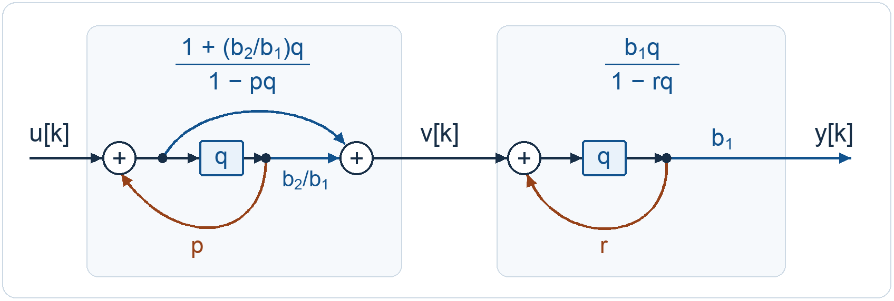
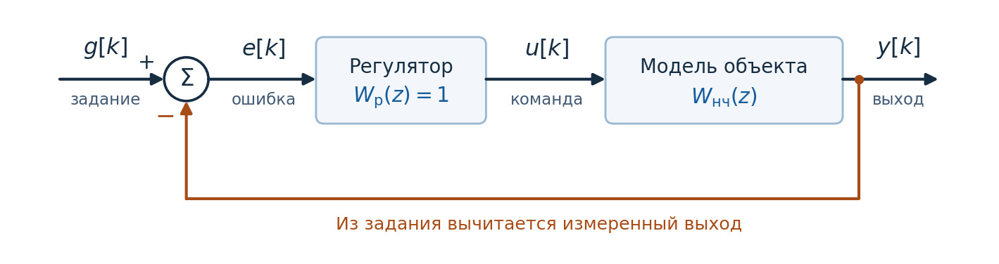

# Лабораторная работа №1. Передаточные функции цифровых систем управления

## Карта темы

У неподвижного двигателя на одну десятую секунды нажали кнопку пуска и отпустили. Пока кнопка нажата, команда равна $1$. После отпускания команда равна $0$, а вал ещё крутится. Датчик замеряет скорость в момент нажатия и дальше каждые $0{,}1$ секунды. Что окажется в первых трёх строках журнала?

| Время, с | Команда с этого момента | Скорость по модели |
| --------:| -----------------------:| ------------------:|
| $0$      | $1$                     | $0$                |
| $0{,}1$  | $0$                     | $0{,}080$          |
| $0{,}2$  | $0$                     | $0{,}049$          |

Команда и скорость живут по разным правилам. Команду можно выключить сразу, а скорость зависит и от того, что подавали раньше. Отсюда задача лабораторной. По формуле непрерывного объекта нужно получить модель, которая считает показания датчика по тактам. Затем по этой модели строят схему с памятью. В конце подключают обратную связь и получают формулу для ошибки между заданием и измеренным выходом.

## 1. Что задано в условии

| Цифра      | Что задано                                                         | Что должно получиться                                                           |
| ---------- | ------------------------------------------------------------------ | ------------------------------------------------------------------------------- |
| Первая $2$ | Непрерывный объект $W_{\mathrm{н}}(s)=\dfrac{s+0{,}5}{(s+2)(s+3)}$ | Дискретная передаточная функция $W_{\mathrm{нч}}(z)$ при периоде $T=0{,}1$ с    |
| Вторая $2$ | Последовательная декомпозиция                                      | Два звена, соединённые одно за другим, и их диаграмма состояний                 |
| Третья $2$ | Выходом всей системы считается ошибка                              | Передаточная функция $W_{eg}(z)=E(z)/G(z)$ при регуляторе $W_{\mathrm{р}}(z)=1$ |

## 2. От команды двигателя к списку показаний

### Что происходит между измерениями

В первом опыте компьютер выдаёт $1$ в момент $0$, затем $0$ в момент $0{,}1$ с. Команда действует весь интервал, как нажатая кнопка. Цифро-аналоговый преобразователь (ЦАП) держит последнее полученное значение до прихода следующего. <mark>В методичке это называют экстраполятором нулевого порядка.</mark>

Интервал между измерениями обозначают $T$. Номер измерения $k$ начинается с нуля. Например, при $T=0{,}1$ с такт $2$ приходится на момент $2T=0{,}2$ с. Запись $u[2]$ означает команду на такте $2$, а $y[2]$ означает показание датчика в этот момент. В непрерывной модели $y(t)$ означает скорость в любой момент времени, в том числе между измерениями. Дискретная модель должна воспроизвести только те значения, которые попадут в журнал.

### Что значит задержать число на такт

Задержка похожа на колонку "предыдущее значение" в таблице. В каждой строке она показывает число из предыдущей строки. Для команды $1,0,0,\ldots$ в колонке задержки сначала стоит ноль, потом единица.

| Такт $k$                     | $0$ | $1$ | $2$ |
| ---------------------------- | ---:| ---:| ---:|
| Текущая команда $u[k]$       | $1$ | $0$ | $0$ |
| Задержанная команда $u[k-1]$ | $0$ | $1$ | $0$ |

До начала опыта в памяти ноль. Поэтому задержка на такте $0$ выдаёт $0$, хотя ЦАП уже держит команду $1$. При составлении схемы это два разных действия. ЦАП подаёт на объект текущую команду, а задержка хранит число для следующего вычисления.

Задержку на один такт обозначим $q$. В методичке вместо $q$ пишут $z^{-1}=1/z$. Две задержки подряд дают $q^2$ и сдвигают последовательность на два такта.

## 3. Зачем нужна передаточная функция

Допустим, учебный блок удваивает команду предыдущего такта. На вход $3,4,1,0,\ldots$ он отвечает $0,6,8,2,\ldots$. Формула $2q$ задаёт оба действия. 

Чтобы такое правило действовало сразу на весь список, запишем каждое число при своей степени $q$. Число с такта $0$ стоит без $q$, с такта $1$ при $q$, с такта $2$ при $q^2$.

$$
U(z)=3+4q+q^2,\qquad
Y(z)=2qU(z)=6q+8q^2+2q^3.
$$

В ответе нет свободного числа, поэтому на такте $0$ выход равен нулю. Умножение на $q$ передвинуло все числа на одну позицию. Здесь $q=z^{-1}$. Если подставить это обозначение, получится $U(z)=3+4z^{-1}+z^{-2}$. Это и есть $Z$-преобразование входной последовательности. По коэффициентам можно прочитать исходные числа в порядке тактов.

Формулу, на которую умножают запись входа $U(z)$, чтобы получить запись выхода $Y(z)$, называют передаточной функцией. 

Для учебного блока это $W(z)=Y(z)/U(z)=2q$. Дробь связывает две последовательности целиком. Она работает при нулевых начальных условиях, то есть когда до подачи команды в блоке нет сохранённого сигнала.

Непрерывный объект описывают похожим способом. Чтобы записать функцию времени в виде, удобном для расчётов, применяют преобразование Лапласа. Тогда вместо $u(t)$ и $y(t)$ в формулах работают с записями $U(s)$ и $Y(s)$. Например, дробь $1/(s+2)$ в этой записи соответствует сигналу $e^{-2t}$ после начала опыта. Такое соответствие берём из стандартных пар преобразования. Буква $s$ нужна для записи непрерывной модели, а $z$ для записи последовательностей. Формула объекта $W_{\mathrm{н}}(s)$ задана в условии. Выход получаем по правилу $Y(s)=W_{\mathrm{н}}(s)U(s)$.

## 4. Почему в расчёте сначала держат команду включённой

Когда единичную команду подают один раз, её $Z$-запись равна $1+0q+0q^2+\dots=1$. Из равенства $Y(z)=W_{\mathrm{нч}}(z)U(z)$ тогда получается $Y(z)=W_{\mathrm{нч}}(z)$. Значит, чтобы узнать формулу дискретной модели, достаточно найти отклик на одну такую команду. Его называют импульсным откликом.

После ЦАП эта команда действует ровно $T$ секунд. Её можно представить как разность двух сигналов.

- Первый включается в момент $0$ и дальше остаётся единицей.
- Второй включается через $T$ секунд и тоже остаётся единицей.

До момента $T$ разность равна $1-0=1$. Начиная с $T$ она равна $1-1=0$. Так из двух длинных нажатий получается одно короткое. Сигнал, который включается и дальше держится на единице, называется единичной ступенькой.

У модели из задания действуют два правила. Если входы вычли, их отклики тоже вычитаются. Если вход опаздывает на один такт, отклик опаздывает на столько же. Поэтому достаточно посчитать реакцию на одну ступеньку. Назовём её $h(t)$, а показание на такте $k$ обозначим $h[k]=h(kT)$. Колонку для второй ступеньки получим сдвигом на одну строку. Вот как из этого выходят числа для короткой команды из начала урока.

| Такт $k$ | Ступенька с такта $0$ | Ступенька с такта $1$ | Отклик на команду длительностью один такт |
| --------:| ---------------------:| ---------------------:| -----------------------------------------:|
| $0$      | $0$                   | $0$                   | $0$                                       |
| $1$      | $0{,}080033$          | $0$                   | $0{,}080033$                              |
| $2$      | $0{,}128730$          | $0{,}080033$          | $0{,}128730-0{,}080033=0{,}048697$        |

Числа в первой колонке откликов получим в следующем разделе. Если $H(z)$ обозначает $Z$-запись этой колонки, то сдвинутая колонка записывается как $qH(z)$. Вычитание даёт формулу, которую дальше используем для дискретизации.

$$
W_{\mathrm{нч}}(z)=H(z)-qH(z)=(1-q)H(z).
$$

## 5. Как посчитать отклик

### Записываем реакцию на ступеньку

В записи Лапласа единичной ступеньке соответствует $1/s$. Чтобы получить запись отклика на ступеньку, умножаем $1/s$ на передаточную функцию объекта.

$$
W_{\mathrm{н}}(s)\frac{1}{s}
=\frac{s+0{,}5}{s(s+2)(s+3)}.
$$

Под $Z$ в промежуточной части формулы (1.6) методички есть опечатка. Для отклика на ступеньку нужна именно дробь $W_{\mathrm{н}}(s)/s$, как в последней части (1.6).

В приложении А есть строки для дробей $1/s$ и $1/(s+a)$, где $a$ обозначает число. У нашей дроби в знаменателе сразу три множителя. Чтобы воспользоваться таблицей, разложим её на сумму дробей с одним множителем в знаменателе.

### Разбираем дробь на части

Простой пример. Если известна дробь $1/[s(s+1)]$, её можно разложить на $A/s+B/(s+1)$. Умножение на общий знаменатель даёт равенство без дробей. При $s=0$ остаётся $A$, при $s=-1$ остаётся $-B$.

$$
\frac{1}{s(s+1)}=\frac{A}{s}+\frac{B}{s+1}
\quad\Longrightarrow\quad
1=A(s+1)+Bs
\quad\Longrightarrow\quad A=1,\quad B=-1.
$$

Смысл подстановки в том, чтобы обнулить остальные слагаемые и найти один коэффициент за раз. Подстановки делают в равенство после сокращения знаменателей. Например, в исходной дроби при $s=0$ получилось бы деление на ноль.

В нашей дроби три множителя в знаменателе, поэтому неизвестных числителей тоже три. При умножении на общий знаменатель у каждого слагаемого справа сокращается один из множителей. Например, у $A/s$ сокращается $s$ и остаётся $A(s+2)(s+3)$.

$$
\begin{aligned}
\frac{s+0{,}5}{s(s+2)(s+3)}
&=\frac{A}{s}+\frac{B}{s+2}+\frac{C}{s+3},\\
s+0{,}5&=A(s+2)(s+3)+Bs(s+3)+Cs(s+2).
\end{aligned}
$$

| Подстановка | Что остаётся                 | Коэффициент |
| ----------- | ---------------------------- | ----------- |
| $s=0$       | $0{,}5=A\cdot 2\cdot 3$      | $A=1/12$    |
| $s=-2$      | $-1{,}5=B\cdot(-2)\cdot 1$   | $B=3/4$     |
| $s=-3$      | $-2{,}5=C\cdot(-3)\cdot(-1)$ | $C=-5/6$    |

В записи Лапласа реакция на ступеньку принимает вид

$$
\frac{W_{\mathrm{н}}(s)}{s}
=\frac{1}{12s}+\frac{3}{4(s+2)}-\frac{5}{6(s+3)}.
$$

### Находим показания через каждые 0,1 секунды

Приложение А даёт сразу левую и правую колонки таблицы ниже, строки 1 и 4. Средние колонки показывают, какие значения попадают в $Z$-запись. Например, сигнал $e^{-2t}$ в моменты $0,T,2T$ даёт $1$, $e^{-2T}$ и $e^{-4T}$. Если обозначить $e^{-2T}$ через $p$, получится список $1,p,p^2,\ldots$. Каждый следующий отсчёт равен предыдущему, умноженному на $p$.

$$
p=e^{-2T}=e^{-0{,}2}\approx0{,}818731,\qquad
r=e^{-3T}=e^{-0{,}3}\approx0{,}740818.
$$

Здесь $e$ в степени обозначает постоянное число, примерно $2{,}71828$. Например, значение $p$ можно получить на калькуляторе как $\exp(-0{,}2)$.

| Дробь по Лапласу | Сигнал после начала опыта | Значение на такте $k$ | $Z$-запись из таблицы |
| ---------------- | ------------------------- | --------------------- | --------------------- |
| $1/s$            | $1$                       | $1$                   | $z/(z-1)=1/(1-q)$     |
| $1/(s+2)$        | $e^{-2t}$                 | $p^k$                 | $z/(z-p)=1/(1-pq)$    |
| $1/(s+3)$        | $e^{-3t}$                 | $r^k$                 | $z/(z-r)=1/(1-rq)$    |

У второй строки $Z$-запись начинается с членов $1+pq+p^2q^2+\dots$. Если из неё вычесть ту же строку, умноженную на $pq$, останется $1$. Поэтому строка, умноженная на $1-pq$, даёт $1$, а её короткая запись равна $1/(1-pq)$.

Коэффициенты $A$, $B$ и $C$ из разложения переходят в формулу для отсчётов. Из трёх средних значений собираем $h[k]$.

$$
\begin{aligned}
h[k]&=\frac{1}{12}+\frac{3}{4}p^k-\frac{5}{6}r^k,\\
h[0]&=\frac{1}{12}+\frac{3}{4}-\frac{5}{6}=0,\\
h[1]&=\frac{1}{12}+\frac{3}{4}p-\frac{5}{6}r\approx0{,}080033,\\
h[2]&=\frac{1}{12}+\frac{3}{4}p^2-\frac{5}{6}r^2\approx0{,}128730.
\end{aligned}
$$

При постоянно включённой единичной команде это прямые показания датчика. При короткой команде на такте $2$ из $h[2]$ вычитается $h[1]$, как в таблице выше.

### Получаем передаточную функцию дискретного объекта

Теперь те же три коэффициента умножаем на дроби из правой колонки. Их сумма даёт $H(z)$, запись отклика на ступеньку. Множитель $1-q$ превращает её в запись отклика на команду длиной один такт.

$$
W_{\mathrm{нч}}(z)=(1-q)\left(\frac{1}{12(1-q)}+\frac{3}{4(1-pq)}-\frac{5}{6(1-rq)}\right).
$$

Чтобы собрать одну дробь, сначала выделим постоянные части. У первой дроби $1-q$ сокращается. Во второй запишем $1-q=(1-pq)+(p-1)q$. Тогда

$$
\frac{1-q}{1-pq}=1+\frac{(p-1)q}{1-pq}.
$$

Для третьей дроби получается то же выражение с $r$. Постоянные части $1/12+3/4-5/6$ дают ноль. Остаются два слагаемых. Обозначим их коэффициенты через $c_p=\frac34(p-1)$ и $c_r=\frac56(1-r)$.

$$
\begin{aligned}
W_{\mathrm{нч}}(z)
&=\frac{c_pq}{1-pq}+\frac{c_rq}{1-rq}\\
&=\frac{c_pq(1-rq)+c_rq(1-pq)}{(1-pq)(1-rq)}\\
&=\frac{(c_p+c_r)q-(rc_p+pc_r)q^2}{1-(p+r)q+prq^2}\\
&=\frac{b_1q+b_2q^2}{1-(p+r)q+prq^2}.
\end{aligned}
$$

Здесь $b_1=c_p+c_r\approx0{,}080032881$, а $b_2=-(rc_p+pc_r)\approx-0{,}076117740$. Обозначим весь числитель через $N(q)$, а знаменатель через $D(q)$. Чтобы записать ответ через $z$, подставим $q=1/z$ и домножим числитель и знаменатель на $z^2$. Например, член $b_1q$ превратится в $b_1z$.

$$
W_{\mathrm{нч}}(z)\approx\frac{0{,}080032881z-0{,}076117740}{z^2-1{,}559548974z+0{,}606530660}.
$$

Значение $b_1$ совпадает с первым ненулевым отсчётом короткого отклика, $h[1]-h[0]$. При дальнейших вычислениях используем $p=e^{-0{,}2}$ и $r=e^{-0{,}3}$ без промежуточного округления.

## 6. Как дробь превращается в схему с двумя ячейками памяти

Вторая цифра варианта требует каскад. Выход первого блока становится входом второго. Это похоже на две операции в калькуляторе. Если сначала умножить число на $2$, а результат на $3$, получится умножение на $2\cdot3$. Поэтому в последовательном соединении формулы блоков перемножаются.

В знаменателе уже есть два множителя, $(1-pq)$ и $(1-rq)$. В числителе выносим общий множитель $b_1q$. Тогда выражение $b_1q+b_2q^2$ превращается в $b_1q(1+aq)$, где $a=b_2/b_1\approx-0{,}951081$. Распределим множители между двумя звеньями.

$$
W_{\mathrm{нч}}(z)=
\underbrace{\frac{1+aq}{1-pq}}_{\text{звено 1}}
\cdot
\underbrace{\frac{b_1q}{1-rq}}_{\text{звено 2}}.
$$

Как знаменатель даёт ячейку памяти? Возьмём правило $x[k]=u[k]+0{,}5x[k-1]$. К текущему входу оно прибавляет половину прошлого результата. При входе $1,0,0,\dots$ последовательно получатся $1$, $0{,}5$, $0{,}25$. В $Z$-записи имеем $X=U+0{,}5qX$. Когда переносим $0{,}5qX$ влево, получаем $X(1-0{,}5q)=U$. Так в дроби $X/U=1/(1-0{,}5q)$ появляется минус. В самой схеме прошлое число по-прежнему прибавляется с множителем $0{,}5$.

Поэтому в первом звене текущий вход складывается с прошлым внутренним числом, умноженным на $p$. Получаем новое внутреннее число $x_1[k]$. Числитель $1+aq$ говорит, как из него получить выход $v[k]$. Берём текущее $x_1[k]$ и прибавляем прошлое с коэффициентом $a$. Во втором звене входом служит $v[k]$, в память возвращается внутреннее число с коэффициентом $r$, а числитель $b_1q$ берёт на выход только задержанное число и умножает его на $b_1$.

Кружки со знаком $+$ складывают входы. Точки перед задержками соответствуют текущим значениям $x_1[k]$ и $x_2[k]$. После задержек доступны прежние значения $m_1=x_1[k-1]$ и $m_2=x_2[k-1]$. Эти два числа составляют состояние схемы. На рисунке коэффициент $a$ записан как $b_2/b_1$.

$$
\begin{aligned}
x_1[k]&=u[k]+p\,m_1,& v[k]&=x_1[k]+a\,m_1,\\
x_2[k]&=v[k]+r\,m_2,& y[k]&=b_1m_2.
\end{aligned}
$$

На каждом такте обе ячейки сначала отдают старые числа. После вычислений в них записываются новые $x_1[k]$ и $x_2[k]$. Например, при постоянно включённой единичной команде на такте $0$ обе ячейки выдают нули, поэтому $v[0]=x_2[0]=1$, а $y[0]=0$. В обе ячейки записывается $1$. На такте $1$ получаем $v[1]=1+p+a\approx0{,}867650$, затем $x_2[1]=v[1]+r\approx1{,}608468$. На выходе ещё используется старая единица из второй ячейки, поэтому $y[1]=b_1\approx0{,}080033$. На такте $2$ выход берётся из только что рассчитанного $x_2[1]$ и равен $b_1x_2[1]\approx0{,}128730$.

Три показания совпали с $h[0]$, $h[1]$ и $h[2]$. Так проверяется, что схема реализует полученную дискретную модель.

## 7. Что меняется, когда подключена обратная связь

До этого команда двигателю была известна заранее. В одном опыте она действовала всё время, в другом закончилась через один такт. Теперь задаём желаемую скорость. Если она равна $1$, а датчик показал $0{,}080033$, разница составляет $1-0{,}080033=0{,}919967$. По условию регулятор пропускает эту разницу дальше без изменения. Поэтому двигатель получает команду $0{,}919967$ на том же такте.

Используем $g[k]$ для заданной скорости, $y[k]$ для измеренной, $e[k]=g[k]-y[k]$ для разницы. Возврат показания к вычитанию называется отрицательной обратной связью. При $W_{\mathrm{р}}(z)=1$ имеем $u[k]=e[k]$.

Чтобы понять, почему в итоговой дроби возникает сумма $1+W_{\mathrm{нч}}$, можно взять объект, который просто умножает команду на $2$. При задании $9$ его выход равен $2e$, а ошибка равна $9-2e$. Выходит, $e=9-2e$, то есть $(1+2)e=9$. Ошибка равна $3$, выход равен $6$, и разность $9-6$ снова даёт $3$.

В нашей схеме место числа $2$ занимает передаточная функция каскада. В $Z$-записи обозначим задание через $G$, ошибку через $E$, выход через $Y$. Тогда из сумматора получаем $E=G-Y$, а из каскада $Y=W_{\mathrm{нч}}E$. Подстановка даёт

$$
E=G-W_{\mathrm{нч}}E,\qquad (1+W_{\mathrm{нч}})E=G.
$$

Третья цифра просит выразить $E/G$. Вставляем вместо $W_{\mathrm{нч}}$ дробь $N/D$ и приводим $1+N/D$ к общему знаменателю.

$$
W_{eg}(z)=\frac{E(z)}{G(z)}
=\frac{1}{1+W_{\mathrm{нч}}(z)}
=\frac{1}{1+N/D}
=\frac{D}{D+N}.
$$

В знаменателе складываем коэффициенты при одинаковых степенях $q$. При $q$ получается $b_1-(p+r)$, при $q^2$ получается $pr+b_2$. После перехода к степеням $z$ получаем

$$
\boxed{W_{eg}(z)\approx\frac{z^2-1{,}559548974z+0{,}606530660}{z^2-1{,}479516093z+0{,}530412919}}.
$$

При единичном задании на такте $0$ двигатель ещё стоит, поэтому ошибка $1$ даёт первую команду $1$. На такте $1$ датчик показывает $b_1$, и команда уменьшается до $1-b_1\approx0{,}919967$. Вот где расходятся два опыта. При разомкнутой схеме мы сами задаём очередную команду. При обратной связи очередную команду определяет показание датчика.

## Как всё складывается

Три расчёта отвечают на разные вопросы. $W_{\mathrm{нч}}(z)$ определяет показания датчика по последовательности команд. Диаграмма показывает, какие два числа хранить, чтобы вычислять эти показания на каждом такте. $W_{eg}(z)$ связывает задание с ошибкой, когда показание датчика возвращается к регулятору.

В отчёте нужны титульный лист, цель, краткая теория, ход решения и выводы. В ход решения входят расчёт дискретной функции по таблице из приложения А, произведение двух звеньев с диаграммой состояний и вывод $W_{eg}$. Шаблон титульного листа упомянут как приложение Б. В полученном файле этого приложения нет.

## Проверь себя

**1. Единичную команду подали только на такте $1$, а до него вход был нулевым. На каком такте датчик покажет первый ненулевой результат и сколько?**

Ответ

На такте $2$ получим $0{,}080033$. Весь отклик на короткую команду сдвинется на один такт, потому что на один такт позже изменилась сама команда.

**2. Почему на такте $1$ выход каскада берётся из $x_2[0]$, хотя к этому моменту уже рассчитано новое $x_2[1]$?**

Ответ

Множитель $b_1$ стоит после задержки. На такте $1$ она выдаёт $x_2[0]$. Новое число $x_2[1]$ станет доступно после задержки на такте $2$.

**3. Если последняя цифра варианта стала бы $1$, какую дробь потребовалось бы вывести?**

Ответ

Тогда нужен выход $Y$ по заданию $G$. Поскольку $Y=W_{\mathrm{нч}}E$, получим $Y/G=(N/D)\cdot D/(D+N)=N/(D+N)$.

