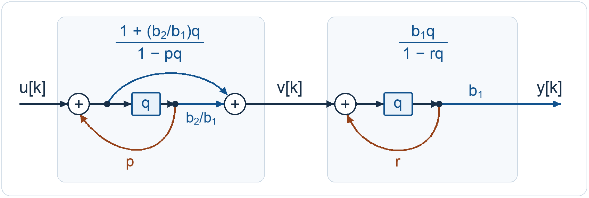
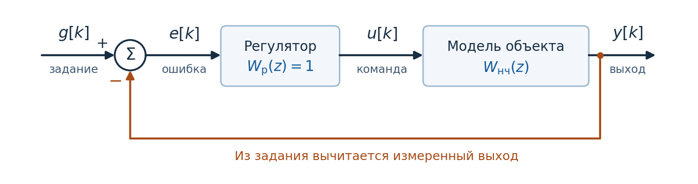

# Решение лабораторной работы №1

## Исходные данные

$$
W_{\mathrm{н}}(s)=\frac{s+0{,}5}{(s+2)(s+3)},\qquad
T=0{,}1\ \text{с},\qquad W_{\mathrm{р}}(z)=1.
$$

Требуется найти дискретную передаточную функцию объекта, построить диаграмму состояний двух последовательных звеньев и вывести функцию ошибки $W_{eg}(z)=E(z)/G(z)$ для замкнутой системы.

## 1. Дискретная передаточная функция

Изображение единичной ступеньки равно $1/s$. Изображение отклика непрерывного объекта раскладываем на простые дроби.

$$
\frac{W_{\mathrm{н}}(s)}{s}
=\frac{s+0{,}5}{s(s+2)(s+3)}
=\frac{A}{s}+\frac{B}{s+2}+\frac{C}{s+3}.
$$

Домножаем на общий знаменатель.

$$
s+0{,}5=A(s+2)(s+3)+Bs(s+3)+Cs(s+2).
$$

При $s=0$ получаем $6A=0{,}5$, при $s=-2$ получаем $-2B=-1{,}5$, при $s=-3$ получаем $3C=-2{,}5$. Значит, $A=1/12$, $B=3/4$, $C=-5/6$.

Обозначим $q=z^{-1}$, $p=e^{-2T}$ и $r=e^{-3T}$. Отклик на ступеньку в моменты $t=kT$ и его $Z$-изображение по строкам 1 и 4 приложения А равны

$$
\begin{aligned}
h[k]&=\frac{1}{12}+\frac{3}{4}p^k-\frac{5}{6}r^k,\\
H(z)&=\frac{1}{12(1-q)}+\frac{3}{4(1-pq)}-\frac{5}{6(1-rq)}.
\end{aligned}
$$

Экстраполятор удерживает единичную команду в течение одного такта. Такой вход равен ступеньке минус ступенька, задержанная на $T$. Соответственно, отклик на этот вход равен $h[k]-h[k-1]$, где $h[-1]=0$. В $Z$-записи этому соответствует множитель $1-q$.

$$
\begin{aligned}
W_{\mathrm{нч}}(z)&=(1-q)H(z)
=\frac{c_pq}{1-pq}+\frac{c_rq}{1-rq}
=\frac{N(q)}{D(q)},\\
c_p&=\frac{3}{4}(p-1),\qquad c_r=\frac{5}{6}(1-r),\\
N(q)&=b_1q+b_2q^2,\qquad b_1=c_p+c_r,\qquad b_2=-(rc_p+pc_r),\\
D(q)&=(1-pq)(1-rq)=1-(p+r)q+prq^2.
\end{aligned}
$$

Подставляем $T=0{,}1$ с и переходим от $q$ к степеням $z$. Коэффициенты округлены при записи.

$$
\boxed{W_{\mathrm{нч}}(z)\approx
\frac{0{,}080032881z-0{,}076117740}{z^2-1{,}559548974z+0{,}606530660}}.
$$

## 2. Последовательная декомпозиция

Выносим множитель $b_1q$ из $N(q)$. Обозначим $a=b_2/b_1\approx-0{,}951080850$. Получаем два звена.

$$
W_{\mathrm{нч}}(z)=
\underbrace{\frac{1+aq}{1-pq}}_{W_1(z)}
\cdot
\underbrace{\frac{b_1q}{1-rq}}_{W_2(z)}.
$$

Пусть $m_1[k]$ и $m_2[k]$ хранят значения на выходах двух задержек в начале такта. Через $v[k]$ обозначим выход первого звена. Уравнения диаграммы при $m_1[0]=m_2[0]=0$ имеют вид

$$
\begin{aligned}
x_1[k]&=u[k]+p\,m_1[k], & v[k]&=x_1[k]+a\,m_1[k],\\
x_2[k]&=v[k]+r\,m_2[k], & y[k]&=b_1m_2[k],\\
m_1[k+1]&=x_1[k], & m_2[k+1]&=x_2[k].
\end{aligned}
$$

При $u[k]=1$ с такта $0$ получаем $y[0]=0$, $y[1]=b_1\approx0{,}080033$, $y[2]=b_1(1+p+a+r)\approx0{,}128730$. Это те же три отсчёта, что и в $h[k]$.

## 3. Передаточная функция по ошибке

При отрицательной обратной связи $E=G-Y$. По условию регулятор передаёт ошибку без изменения, поэтому $Y=W_{\mathrm{нч}}E$. Подставляем это выражение в первое уравнение и выражаем $E/G$.

$$
\begin{aligned}
E&=G-W_{\mathrm{нч}}E,\\
(1+W_{\mathrm{нч}})E&=G,\\
W_{eg}(z)&=\frac{E(z)}{G(z)}
=\frac{1}{1+W_{\mathrm{нч}}(z)}
=\frac{D(q)}{D(q)+N(q)}\\
&=\frac{1-(p+r)q+prq^2}{1+\bigl(b_1-p-r\bigr)q+(pr+b_2)q^2}.
\end{aligned}
$$

Домножаем числитель и знаменатель на $z^2$.

$$
\boxed{W_{eg}(z)\approx
\frac{z^2-1{,}559548974z+0{,}606530660}{z^2-1{,}479516093z+0{,}530412919}}.
$$

При единичном задании и нулевой начальной памяти $y[0]=0$ и $e[0]=1$. На следующем такте $y[1]=b_1$, поэтому $e[1]=1-b_1\approx0{,}919967$. Эти значения совпадают с первыми двумя отсчётами отклика $W_{eg}$ на единичную ступеньку.
