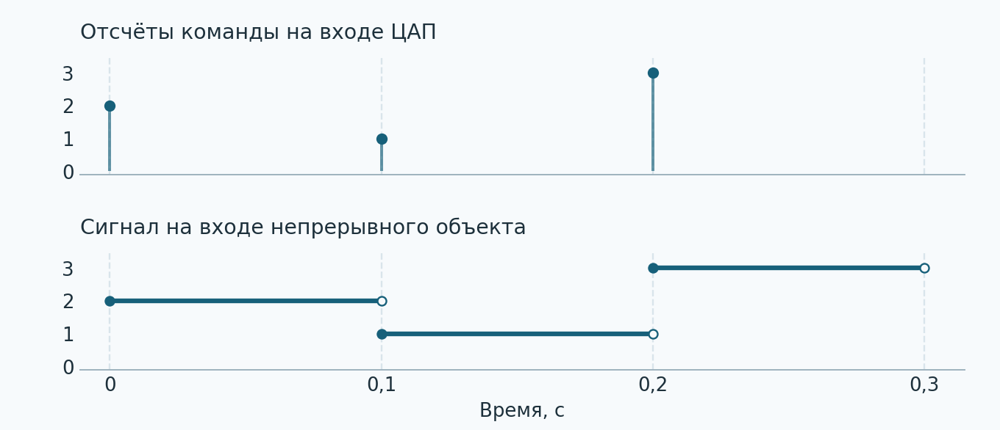
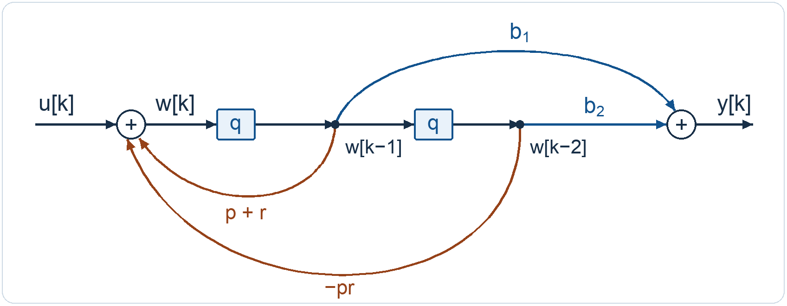
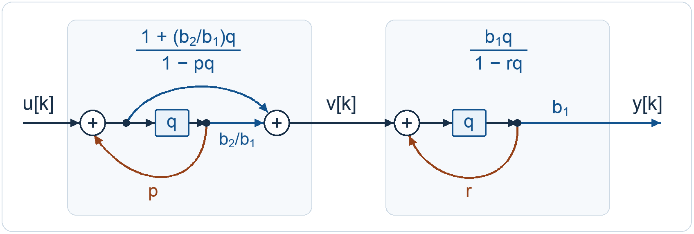
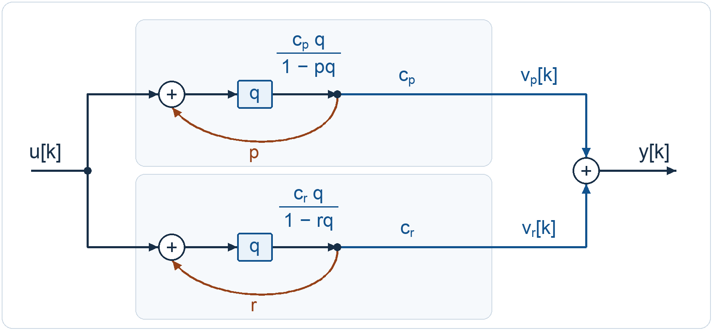

# Лабораторная работа №6. Передаточные функции цифровых систем управления

Дисциплина «Управляющие информационные системы»

## Карта темы

Регулятор температуры получает показание датчика раз в несколько секунд. Между показаниями команда нагревателю остаётся прежней, а температура продолжает меняться. Чтобы рассчитывать следующие показания, строим дискретную модель объекта вместе с устройством, которое удерживает команду.

Путь в лабораторной такой. Удержание команды → дискретная передаточная функция → диаграмма с задержками → замыкание обратной связи. Для расчёта пригодятся передаточная функция непрерывного объекта и разложение рациональной дроби. Готовая дискретная модель нужна, например, чтобы проверять устойчивость контура и подбирать регулятор.

### Что определяется номером варианта

Номер варианта состоит из трёх цифр. Их выбирают независимо по столбцам таблицы 1 методички.

| Позиция цифры | Что взять из таблицы 1 |
| --- | --- |
| Первая | Строку $1$–$9$ с передаточной функцией объекта $W_{\mathrm{н}}(s)$. |
| Вторая | $1$ для непосредственной, $2$ для последовательной или $3$ для параллельной декомпозиции. |
| Третья | $1$ для функции по заданию $W_{yg}(z)=Y(z)/G(z)$, $2$ для функции по ошибке $W_{eg}(z)=E(z)/G(z)$. |

Для всех вариантов период дискретизации $T=0{,}1\,\text{с}$, цифровой регулятор $W_{\mathrm{р}}(z)=1$. Номер индивидуального варианта выдаёт преподаватель. На уроке разберём все три схемы на одном объекте, чтобы можно было выбрать нужную для своего варианта.

Передаточные функции из таблицы 1

| Первая цифра | $W_{\mathrm{н}}(s)$ |
| --- | --- |
| 1 | $7(s+3)/[s(s+2)]$ |
| 2 | $(s+0{,}5)/[(s+3)(s+2)]$ |
| 3 | $10(s+1{,}5)/[(s+3)(s+2)]$ |
| 4 | $(s+4)/[s(s+2)(s+5)]$ |
| 5 | $5(0{,}8s+1)/[s(s+2)^2]$ |
| 6 | $1/[(s+4)(s+3)^2]$ |
| 7 | $10/[(s+4)(s+3)(s+2)]$ |
| 8 | $2(s+1)/[s(s^2+s+3)]$ |
| 9 | $2(s+1)/[(s+3)(s^2+s+4)]$ |

## 1. Команда между отсчётами

На первом шаге определяем, что именно будем дискретизировать. Пусть $u[k]$ обозначает команду регулятора на такте $k$, а $u(t)$ обозначает сигнал, который получает непрерывный объект. Если $u[0]=2$, $u[1]=1$ и $u[2]=3$, то на интервалах $[0;\,0{,}1)$, $[0{,}1;\,0{,}2)$ и $[0{,}2;\,0{,}3)$ сигнал $u(t)$ равен соответственно $2$, $1$ и $3$. Эту операцию выполняет экстраполятор нулевого порядка в цифро-аналоговом преобразователе (ЦАП). В англоязычных источниках он называется zero-order hold, или ZOH.

На входе дискретной модели оставим команды $u[k]$, на выходе оставим отсчёты $y[k]=y(kT)$. Тогда передаточная функция $W_{\mathrm{нч}}(z)=Y(z)/U(z)$ описывает пару «экстраполятор + непрерывный объект» в моменты измерения. Между отсчётами $y(t)$ по-прежнему меняется по законам непрерывного объекта. [Дискретизация с ZOH в документации MathWorks](https://www.mathworks.com/help/control/ug/continuous-discrete-conversion-methods.html)

### От ступеньки к импульсу длиной в один такт

Один единичный отсчёт на входе ЦАП превращается в прямоугольный импульс длиной $T$. Такой импульс можно получить из двух ступенек. Первая поднимает сигнал в момент $0$, вторая опускает его в момент $T$. Если $h(t)$ обозначает реакцию объекта на первую ступеньку, то реакция на весь импульс равна $h(t)-h(t-T)$, где $h(t)=0$ при $t<0$.

Пусть первые отсчёты реакции на ступеньку равны $0$, $0{,}2$, $0{,}5$. Тогда реакция на импульс начинается с $0$, $0{,}2-0=0{,}2$, $0{,}5-0{,}2=0{,}3$. В расчёте повторится та же операция, вычитание предыдущего отсчёта из текущего.

## 2. Дискретная передаточная функция

Теперь запишем вычитание отсчётов через $z$. $Z$-изображение последовательности $h[0],h[1],h[2],\ldots$ собирает её значения в ряд.

$$
H(z)=h[0]+h[1]z^{-1}+h[2]z^{-2}+\ldots
$$

Каждое умножение на $z^{-1}$ сдвигает последовательность на один такт. В $z^{-1}H(z)$ коэффициенты идут как $0,h[0],h[1],\ldots$. Обозначим $q=z^{-1}$. Вычитанию предыдущего отсчёта соответствует умножение на $1-q$.

В непрерывной модели $s$ служит переменной преобразования Лапласа. Для единичной ступеньки, которая равна $1$ с момента $t=0$, изображение по Лапласу равно $1/s$. Поэтому переходную характеристику $h(t)$ получаем обратным преобразованием Лапласа от $W_{\mathrm{н}}(s)/s$. Берём значения $h[k]=h(kT)$ и применяем $Z$-преобразование к ним. Так получается последняя часть формулы (1.6) методички.

$$
W_{\mathrm{нч}}(z)=(1-z^{-1})\mathcal Z\!\left\{\left.\mathcal L^{-1}\!\left[\frac{W_{\mathrm{н}}(s)}s\right]\right|_{t=kT}\right\}.
$$

Передаточная функция связывает $Z$-изображения выхода и входа при нулевых начальных условиях. Таблица из приложения А даёт сразу $Z$-изображение отсчётов для дроби по Лапласу. Первые три пары пригодятся для вещественных полюсов.

| Член дроби по Лапласу | Отсчёты при $t=kT$ | $Z$-изображение через $q$ |
| --- | --- | --- |
| $1/s$ | $1$ | $1/(1-q)$ |
| $1/(s+\lambda)$ | $p^k$, где $p=e^{-\lambda T}$ | $1/(1-pq)$ |
| $1/(s+\lambda)^2$ | $kT\,p^k$ | $Tpq/(1-pq)^2$ |

Вторая строка получается из геометрического ряда $1+pq+p^2q^2+\ldots$. Для третьей каждый отсчёт второй строки дополнительно умножается на $kT$. При $\lambda=0$ третья строка даёт пару для $1/s^2$.

Пары для комплексных полюсов в строках 8 и 9

Знаменатель $s^2+s+a$ приводим к виду $(s+\alpha)^2+\beta^2$. Здесь $\alpha=1/2$, $\beta=\sqrt{a-1/4}$, а $a$ равен $3$ или $4$. Линейный числитель записываем как сумму слагаемого с $s+\alpha$ и постоянного слагаемого. Тогда применимы две пары ниже. Обозначим $\rho=e^{-\alpha T}$ и $\theta=\beta T$.

| Член дроби по Лапласу | Отсчёты при $t=kT$ | $Z$-изображение через $q$ |
| --- | --- | --- |
| $(s+\alpha)/[(s+\alpha)^2+\beta^2]$ | $\rho^k\cos(k\theta)$ | $(1-\rho q\cos\theta)/(1-2\rho q\cos\theta+\rho^2q^2)$ |
| $\beta/[(s+\alpha)^2+\beta^2]$ | $\rho^k\sin(k\theta)$ | $\rho q\sin\theta/(1-2\rho q\cos\theta+\rho^2q^2)$ |

Если в числителе константа $C$, вынеси множитель $C/\beta$, чтобы в дроби осталось $\beta$. Полученную сумму $Z$-изображений по-прежнему умножаем на $1-q$.

### Расчёт для первой цифры 3

Из таблицы 1 берём $W_{\mathrm{н}}(s)=10(s+1{,}5)/[(s+2)(s+3)]$. Для переходной характеристики делим эту дробь на $s$. В знаменателе получаем три разных линейных множителя. Их корни $0$, $-2$ и $-3$ называются простыми полюсами этой дроби. Записываем по одному слагаемому на каждый множитель.

$$
\frac{10(s+1{,}5)}{s(s+2)(s+3)}
=\frac{A}{s}+\frac{B}{s+2}+\frac{C}{s+3}.
$$

Домножаем на $s(s+2)(s+3)$. Подстановка $s=0$ оставляет только $6A=15$, откуда $A=2{,}5$. При $s=-2$ остаётся $-2B=-5$, откуда $B=2{,}5$. При $s=-3$ остаётся $3C=-15$, откуда $C=-5$. Этот приём работает для простых полюсов. Если полюс кратный, выписываем все степени его множителя в знаменателе и недостающие коэффициенты находим сравнением степеней $s$ после умножения на общий знаменатель.

Обозначим $p=e^{-2T}\approx0{,}818731$ и $r=e^{-3T}\approx0{,}740818$. Три дроби дают переходную характеристику $h[k]=2{,}5+2{,}5p^k-5r^k$. В частности, $h[0]=0$, а $h[1]\approx0{,}842736$.

Применяем таблицу к каждому слагаемому и умножаем результат на $1-q$.

$$
W_{\mathrm{нч}}(z)
=(1-q)\left(\frac{2{,}5}{1-q}+\frac{2{,}5}{1-pq}-\frac{5}{1-rq}\right).
$$

Пишем $1-q=(1-pq)+(p-1)q$ и так же раскладываем $1-q$ через $r$. Постоянные слагаемые $2{,}5+2{,}5-5$ в результате сокращаются, остаются две дроби с $q$ в числителях.

$$
W_{\mathrm{нч}}(z)=\frac{c_pq}{1-pq}+\frac{c_rq}{1-rq},
\qquad c_p=2{,}5(p-1),\qquad c_r=5(1-r).
$$

Приводим их к общему знаменателю. В числителе получаем $c_pq(1-rq)+c_rq(1-pq)$. Перемножаем $(1-pq)(1-rq)$ и собираем коэффициенты при одинаковых степенях $q$.

$$
\begin{aligned}
W_{\mathrm{нч}}(z)&=\frac{N(q)}{D(q)},\\
N(q)&=b_1q+b_2q^2, & b_1&=c_p+c_r\approx0{,}842736, & b_2&=-(rc_p+pc_r)\approx-0{,}725282,\\
D(q)&=1-d_1q+d_2q^2, & d_1&=p+r\approx1{,}559549, & d_2&=pr\approx0{,}606531.
\end{aligned}
$$

Чтобы вернуться к степеням $z$, домножаем числитель и знаменатель на $z^2$. Получаем $(b_1z+b_2)/(z^2-d_1z+d_2)$. Для проверок и дальнейших вычислений сохраняй точные $p,r$ и округляй только результат.

## 3. Диаграммы состояний

Дробь задаёт связь между входом и выходом. Диаграмма показывает, какие значения нужно хранить, чтобы вычислять выход на каждом такте. Блок $q$ отдаёт значение, которое получил на предыдущем такте. Стрелка с коэффициентом умножает на него сигнал, а сумматор складывает сигналы со знаками, указанными на ветвях.

### Непосредственная декомпозиция

Оставляем общую дробь $N(q)/D(q)$. Вводим внутренний сигнал $w[k]$. Сначала получаем его через знаменатель, $D(q)W(z)=U(z)$. Затем применяем числитель, $Y(z)=N(q)W(z)$. Здесь $W(z)$ обозначает $Z$-изображение внутреннего сигнала $w[k]$.

Читаем $qW(z)$ как $w[k-1]$, а $q^2W(z)$ как $w[k-2]$. Переносим слагаемые с задержками в правую часть первого равенства, чтобы выразить текущий $w[k]$ через уже известные значения.

$$
\begin{aligned}
w[k]&=u[k]+d_1w[k-1]-d_2w[k-2],\\
y[k]&=b_1w[k-1]+b_2w[k-2].
\end{aligned}
$$

Оба сумматора используют одну и ту же память. На такте $k$ сначала берём старые $w[k-1]$ и $w[k-2]$, вычисляем $w[k]$ и $y[k]$, затем сдвигаем память. При входе $u[0]=1$ и нулевой памяти получаем $w[0]=1$ и $y[0]=0$. На следующем такте в первой ячейке лежит $1$, поэтому $y[1]=b_1$.

### Последовательная декомпозиция

Разбиваем исходную дробь на произведение двух звеньев. Первому отдаём полюс $p$, второму отдаём $r$. Числитель разбиваем на множители $1+(b_2/b_1)q$ и $b_1q$.

$$
W_{\mathrm{нч}}(z)=\frac{1+(b_2/b_1)q}{1-pq}\cdot\frac{b_1q}{1-rq}.
$$

Выход первого звена $v[k]$ поступает на вход второго. Для каждого звена переносим слагаемое с прошлым выходом в правую часть уравнения.

$$
\begin{aligned}
v[k]&=p\,v[k-1]+u[k]+(b_2/b_1)u[k-1],\\
y[k]&=r\,y[k-1]+b_1v[k-1].
\end{aligned}
$$

Если полюса комплексно-сопряжённые, можно оставить их в одном звене второго порядка с вещественными коэффициентами. Произведение такого звена с остальными должно восстановить исходную дробь.

### Параллельная декомпозиция

Возвращаемся к сумме дробей, которую получили при дискретизации. Каждое звено принимает один и тот же вход $u[k]$. Общий выход равен сумме выходов ветвей.

$$
\begin{aligned}
v_p[k]&=p\,v_p[k-1]+c_pu[k-1],\\
v_r[k]&=r\,v_r[k-1]+c_ru[k-1],\\
y[k]&=v_p[k]+v_r[k].
\end{aligned}
$$

На такте $1$ при $u[0]=1$ выходы ветвей равны $c_p\approx-0{,}453173$ и $c_r\approx1{,}295909$. Сумма снова даёт $b_1\approx0{,}842736$. Для кратного полюса в разложении могут появиться дроби со степенями одного множителя. Для каждой ветви сохраняем её степень в знаменателе.

## 4. Замыкание обратной связи

До этого мы подавали $u[k]$ прямо на модель объекта. В замкнутой системе на входе известно задание $g[k]$. Из него вычитается измеренный выход $y[k]$, получается ошибка $e[k]=g[k]-y[k]$. Поскольку $W_{\mathrm{р}}(z)=1$, команда регулятора совпадает с ошибкой.

Ошибка проходит через регулятор и объект, а выход возвращается к вычитанию. В уравнении подставляем вместо ошибки разность $G-Y$ и собираем члены с $Y$ слева.

$$
Y=W_{\mathrm{нч}}E=W_{\mathrm{нч}}(G-Y),
\qquad (1+W_{\mathrm{нч}})Y=W_{\mathrm{нч}}G.
$$

Здесь $G$, $E$ и $Y$ обозначают $Z$-изображения задания, ошибки и выхода. Сначала выражаем $Y/G$. Чтобы получить функцию ошибки, вычитаем $Y/G$ из единицы.

$$
W_{yg}(z)=\frac{W_{\mathrm{нч}}}{1+W_{\mathrm{нч}}}=\frac{N}{D+N},
\qquad
W_{eg}(z)=\frac{1}{1+W_{\mathrm{нч}}}=\frac{D}{D+N}.
$$

В нашем примере общий знаменатель равен $1+(b_1-d_1)q+(b_2+d_2)q^2\approx1-0{,}716813q-0{,}118751q^2$. В ответе для третьей цифры $1$ оставляем числитель $N$, для цифры $2$ оставляем $D$. Проверка знака обратной связи следует из исходного вычитания. При сложении двух дробей должно получиться $W_{yg}+W_{eg}=1$.

## Как всё складывается

Разберём номер $321$ как пример чтения таблицы. Цифра $3$ дала непрерывный объект из расчёта выше. При $T=0{,}1\,\text{с}$ нашли $W_{\mathrm{нч}}$ по отсчётам переходной характеристики. Цифра $2$ выбирает каскад. На диаграмме соединяем два звена через $v[k]$, а при проверке перемножаем их дроби и получаем $N/D$. Цифра $1$ выбирает передаточную функцию $W_{yg}=N/(D+N)$.

Проверь дискретизацию единичной ступенькой при разомкнутом контуре. Подай $u[k]=1$ с такта $0$ и запусти каскад с нулевой памятью. Первые выходы составят $0$, $0{,}842736$, $1{,}431742$. Эти числа получаются и из $h[k]=2{,}5+2{,}5p^k-5r^k$ при $k=0,1,2$. Следующий шаг в анализе замкнутого контура состоит в проверке его полюсов, то есть корней знаменателя $D+N$ в переменной $z$.

## Проверь себя

**1. Что увидит непрерывный объект, если $T=0{,}1\,\text{с}$, $u[0]=1$, а все следующие входы нулевые? Как отсюда появляется $1-q$?**

Ответ

Объект получает единицу на $[0;\,0{,}1)$ и ноль после. Это ступенька в момент $0$ минус ступенька в момент $T$. Из отсчёта реакции на первую ступеньку вычитается предыдущий отсчёт. Задержка на такт записывается как множитель $q$, поэтому разность даёт $1-q$.

**2. Почему при нулевой памяти $u[0]=1$ даёт $y[0]=0$ во всех трёх схемах примера?**

Ответ

В общей дроби нет члена $q^0$ в числителе. В непосредственной схеме выход берётся из памяти. В каскаде второе звено использует $v[k-1]$. В параллельной схеме обе ветви используют $u[k-1]$. На такте $0$ все эти старые значения нулевые.

**3. Как изменится расчёт и схема, если пример $321$ заменить на $332$?**

Ответ

Объект и его дискретная функция сохраняются, потому что первая цифра осталась $3$. Вторая цифра выбирает параллельную схему. Третья цифра выбирает функцию ошибки $D/(D+N)$.

**4. При $z=1$ функция разомкнутого объекта равна $2{,}5$. Как в устойчивом замкнутом контуре разделится единичное постоянное задание между выходом и ошибкой?**

Ответ

По заданию получим $2{,}5/(1+2{,}5)=5/7$. По ошибке получим $1/(1+2{,}5)=2/7$. Сумма равна заданию $1$.

**5. Возьми строку 2 таблицы 1. Разложи $W_{\mathrm{н}}(s)/s$, получи $h[k]$ и вычисли первый ненулевой отсчёт импульсной характеристики.**

Ответ

Разложение даёт $1/(12s)+3/[4(s+2)]-5/[6(s+3)]$. После подстановки $t=kT$ получаем $h[k]=1/12+3p^k/4-5r^k/6$. При $k=0$ сумма равна нулю. Первый ненулевой отсчёт импульсной характеристики равен $h[1]-h[0]\approx0{,}080033$.

