# "Горе-инвестор". Сценарий урока для преподавателя

## 1. Узнаём размер семьи и выдаём деньги

"Игра начинается с выбора размера семьи. За каждого человека мы выдаём 10 000 рублей. Сначала возьмём семью из трёх человек и выведем её бюджет".

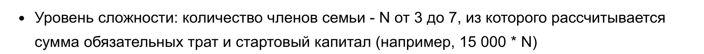

Для троих стартовый капитал составляет 30 000 рублей, продукты и счета за день стоят 2400 рублей. Для каждой семьи из 3–7 человек начального капитала хватает больше чем на два таких дня.

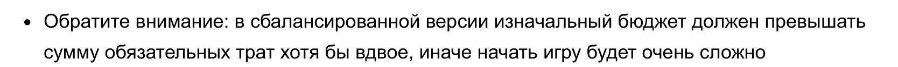

```python
family = 3
start_budget = 10000 * family
print(f"Бюджет семьи: {start_budget} руб.")
```

->

```python
family_text = input("Сколько человек в семье (3–7)? ")
family = int(family_text)
```

## 2. Учим игру переходить к следующему дню

"Семья получила деньги. Теперь игре надо повторять день, пока у семьи есть деньги и игрок хочет продолжать".

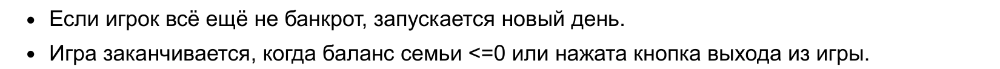

Граница 0 рублей в проверке бюджета взята из правила банкротства на стр. 1 PDF. Счётчик полных дней начинается с 0, а номера дней с 1. После каждого полного дня прибавляем 1. В исходнике кнопки 1 и 2 означают "следующий день" и "закончить игру". Число 50 в `"=" * 50` задаёт длину разделителя на экране.

```python
budget = start_budget
days_lived = 0
print("Если в бюджете останется ноль рублей или меньше, игра закончится.")

while budget > 0:
    day = days_lived + 1
    print(f"\nДень {day}. Бюджет: {budget} руб.")

    print(f"\nОсталось денег: {budget} руб.")
    print("=" * 50)

    if budget <= 0:
        reason = "Банкротство"
    else:
        days_lived += 1
        answer = int(input("1) Следующий день  2) Закончить игру: "))
        if answer == 2:
            reason = "Выход игрока"
            break

print(f"Игра окончена. {reason}. Прожито полных дней: {days_lived}.")
```

### Проверяем ответы игрока

"В игре уже два вопроса с числами. У семьи свои границы, у меню свои. Напишем одну функцию, которая спрашивает число и повторяет вопрос, пока ответ не подойдёт".

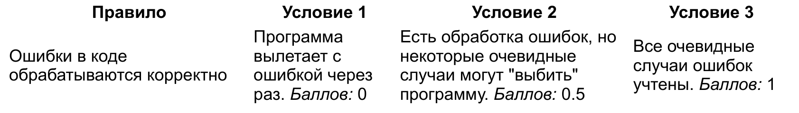

```python
def ask_number(prompt, low, high):
    while True:
        try:
            number = int(input(prompt))
        except ValueError:
            print("Введите целое число.")
            continue
        if low <= number <= high:
            return number
        print(f"Введите число от {low} до {high}.")
```

Замени две строки ввода размера семьи одной строкой `family = ask_number("Сколько человек в семье (3–7)? ", 3, 7)`. В меню замени присваивание `answer = ...` и следующую за ним проверку одной строкой `if ask_number("1) Следующий день  2) Закончить игру: ", 1, 2) == 2:`. Сохрани тело условия.

## 3. Разыгрываем утреннее событие

"Утром семья может получить деньги или столкнуться с расходом. Запишем для каждого события сумму со знаком".

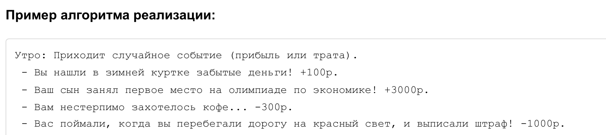

Добавь `import random` в первую строку файла. 

Перед `family = ...` набери словарь `events`. 

```python
events = {
    "Нашли деньги в кармане пальто.": 500,
    "Получили оплату за подработку.": 1800,
    "Пришлось заменить чайник.": -900,
    "Купили лекарства.": -400,
}
```

Под `ask_number()`, выше словаря `events`, набери `morning()`.  `list(events)` собирает тексты событий, `random.choice()` выбирает один из них. `events[event]` находит сумму по выбранному тексту. `return` отдаёт эту сумму туда, где вызвали `morning()`.

```python
def morning():
    event = random.choice(list(events))
    print(event, events[event], "руб.")
    return events[event]
```

Спроси Софию: "что мы запишем в бюджет и в расходы, если при бюджете 30 000 рублей сломался чайник за 900?" 

Затем набери блок утра сразу после вывода номера дня. 

Начинаем день с нулевых поступлений, расходов и результата биржи. Сравнение `change` с нулём показывает, в какую графу записать сумму.

```python
    record = {"день": day, "получено": 0, "потрачено": 0, "биржа": 0}

    change = morning()
    budget += change
    if change > 0:
        record["получено"] += change
    else:
        record["потрачено"] += -change
```

## 4. Покупаем продукты и считаем пропуски

"В обед семья решает, покупать ли продукты. После трёх пропусков подряд на четвёртый день покупка обязательна".

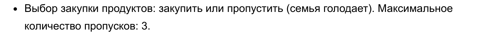

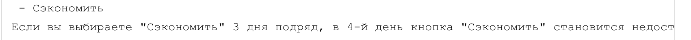

В примере из PDF продукты стоят 15 000 рублей на человека. В этой версии игры тариф 500 рублей на человека, поэтому для троих получится 1500 рублей.

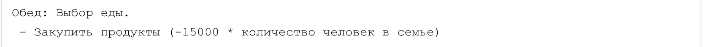

После `morning()` набери функцию. 

```python
def lunch(family, day, skipped_days):
    cost = 500 * family
    if len(skipped_days) == 3:
        print("Семья три дня без продуктов. Сегодня покупаем еду.")
    else:
        print(f"Продукты стоят {cost} руб.")
        answer = ask_number("1) Купить  2) Пропустить: ", 1, 2)
        if answer == 2:
            skipped_days.append(day)
            return 0
    skipped_days.clear()
    return cost
```

Перед `days_lived = 0` добавь `skipped_days = []`. Список создаётся один раз на партию, чтобы помнить пропуски из предыдущих дней. После утреннего блока поставь вызов обеда. Он выполнится, если после события остались деньги.

```python
    if budget > 0:
        cost = lunch(family, day, skipped_days)
        budget -= cost
        record["потрачено"] += cost
```

## 5. Открываем биржу

"Вечером можно пропустить биржу или зайти на неё. Чтобы торговать, нам понадобятся количество акций и цена одной акции".

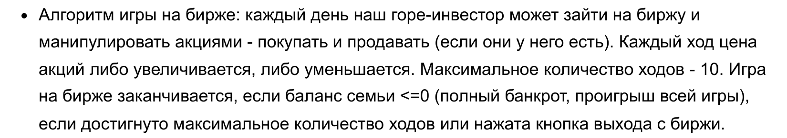

### Выход, ожидание и новая цена

`shares = 0` означает, что семья начинает игру без акций.

Перед `skipped_days = []` добавь `shares = 0` и `price = 500`. Цена живёт между визитами на биржу, поэтому её задаём до цикла дней. Ниже `lunch()` сначала набери `next_price()`. Покажи два варианта ответа для цены 500 и один для цены 100.

Сначала напишем варианты только для уйти и банкроства.

В меню торгов 1 означает покупку, 2 означает продажу, 3 означает ожидание, 4 означает выход. Поэтому `action == 4` завершает визит.

```python
def next_price(price):
    if price == 100:
        return 150
    return price + random.choice([-50, 50])


def trade(budget, shares, price, record):
    fee = 50
    print(f"Комиссия за одну покупку или продажу: {fee} руб.")
    start_value = budget + shares * price
    for move in range(1, 11):
        print(f"Ход {move}/10. Цена: {price} руб. Деньги: {budget} руб. Акций: {shares}.")
        action = ask_number("1) Купить  2) Продать  3) Ждать  4) Уйти: ", 1, 4)
        if action == 4:
            break

        if budget <= 0:
            break
        price = next_price(price)
        print(f"Новая цена: {price} руб.")

    end_value = budget + shares * price
    record["биржа"] = end_value - start_value
    return budget, shares, price
```

В цикле дней сразу после обеда добавь вечер. 

```python
    if budget > 0:
        visit = ask_number("Вечер. 1) На биржу  2) Пропустить: ", 1, 2)
        if visit == 1:
            budget, shares, price = trade(budget, shares, price, record)
```

Зайди на биржу, выбери "Ждать", затем "Уйти". После ожидания цена изменится с 500 до 450 или 550 рублей. Перед выходом спроси, успеет ли цена измениться ещё раз. Покажи, где `break` завершает торги до вызова `next_price()`.

### Покупка

Внутри `trade()` после проверки `action == 4` и перед `if budget <= 0` добавь покупку.

Единица в `limit >= 1` и в границах ввода означает минимум одну акцию на сделку. При покупке верхнюю границу считаем из бюджета, при продаже берём из числа акций семьи.

```python
        if action == 1:
            limit = (budget - fee) // price
            if limit >= 1:
                count = ask_number(f"Сколько купить (1–{limit})? ", 1, limit)
                cost = count * price + fee
                budget -= cost
                shares += count
                record["потрачено"] += cost
            else:
                print("На покупку с комиссией не хватает денег.")
```

При запуске купи две акции на первом ходу. Попроси Софию предсказать, сколько спишется. При цене 500 рублей спишется 1050, а на следующем ходу будет видно две акции. Сначала сверь сумму сделки по цене в момент покупки, затем покажи новую цену.

### Продажа и результат визита

```python
        elif action == 2:
            if shares > 0:
                count = ask_number(f"Сколько продать (1–{shares})? ", 1, shares)
                income = count * price - fee
                budget += income
                shares -= count
                record["получено"] += income
            else:
                print("У семьи нет акций для продажи.")
```

## 6. Оплачиваем счета и закрываем день

"В конце дня семья платит за транспорт, связь и коммунальные услуги. Запишем эти расходы в словарь, чтобы новую трату можно было добавить одной строкой".

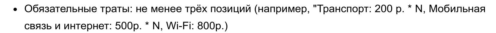

По заданию нужно не меньше трёх обязательных расходов. В игре транспорт стоит 150 рублей на человека, связь стоит 50 рублей на человека, а коммунальные услуги стоят 300 рублей на семью.

Набери `bills()` между `lunch()` и `next_price()`. Перед запуском попроси Софию посчитать расходы для троих. Получится $450 + 150 + 300 = 900$ рублей.

```python
def bills(family):
    expenses = {
        "Транспорт": 150 * family,
        "связь": 50 * family,
        "коммунальные услуги": 300,
    }
    details = ", ".join(f"{name}: {cost}" for name, cost in expenses.items())
    print(f"{details} руб.")
    return sum(expenses.values())
```

Покажи первую запись в `expenses`. Ключ `"Транспорт"` задаёт название расхода, а `150 * family` вычисляет его сумму для всей семьи. Для троих `expenses.items()` даёт пары `("Транспорт", 450)`, `("связь", 150)` и `("коммунальные услуги", 300)`. Выражение `f"{name}: {cost}"` превращает каждую пару в строку, например `"Транспорт: 450"`. `join()` соединяет эти строки через запятую с пробелом. `expenses.values()` даёт только суммы, и `sum()` складывает их.

Вызов поставь после вечернего блока, перед выводом остатка. Если продукты или торги уже довели бюджет до нуля или ниже, проверка пропустит счета. После вывода остатка сработает ветка окончания дня из шага 2.

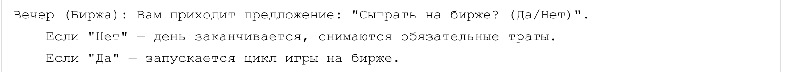

```python
    if budget > 0:
        cost = bills(family)
        budget -= cost
        record["потрачено"] += cost
```

Предложи Софии временно добавить в `expenses` запись `"страховка": 100,` и предсказать, что изменится. При следующем запуске страховка появится в выводе, а общая сумма для троих вырастет до 1000 рублей. После проверки удали эту запись.

## 7. Сохраняем историю партии

"После игры хочется посмотреть, сколько дней продержалась семья и сколько денег ушло за каждый день. Сейчас у нас есть словарь одного дня. Соберём такие словари в список".

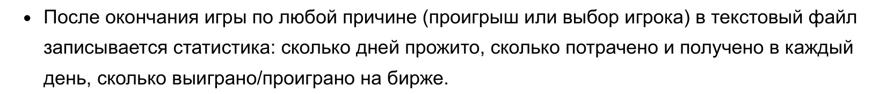

Вставь `history = []` между `skipped_days = []` и `days_lived = 0`. После блока счетов, перед выводом остатка, добавь `history.append(record)` 

```python
    if budget > 0:
        cost = bills(family)
        budget -= cost
        record["потрачено"] += cost
        
->  history.append(record)
    
    print(f"\nОсталось денег: {budget} руб. Акций: {shares}.")
```

После `trade()` и перед словарём `events` набери `save_report()`. Покажи, что цикл `for record in history` берёт по одному словарю за проход, а `file.write()` записывает текст в файл. Символ `\n` начинает новую строку в отчёте.

Сумма `market_total` начинается с 0, потому что в неё ещё не добавили результат ни одного дня.

```python
def save_report(history, days_lived, reason, budget, shares, price):
    market_total = 0
    with open("investor_report.txt", "w", encoding="utf-8") as file:
        file.write(f"Горе-инвестор. {reason}\n")
        file.write(f"Прожито полных дней: {days_lived}\n")
        for record in history:
            market_total += record["биржа"]
            file.write(f"День {record['день']}. Получено: {record['получено']} руб., "
                       f"потрачено: {record['потрачено']} руб., "
                       f"результат биржи: {record['биржа']} руб.\n")
        file.write(f"Общий результат на бирже: {market_total} руб.\n")
        file.write(f"Остаток денег: {budget} руб. Акций: {shares} по {price} руб.\n")
    print("Отчёт записан в investor_report.txt.")
```

Последней строкой файла, после сообщения об окончании игры, вызови `save_report(history, days_lived, reason, budget, shares, price)`. 

```python
print(f"Игра окончена. {reason}. Прожито полных дней: {days_lived}.")
save_report(history, days_lived, reason, budget, shares, price)
```

Открой отчёт из рабочей папки, где запущена игра. Покажи, что `with` закрывает файл, а режим `"w"` заново записывает его после каждой партии.

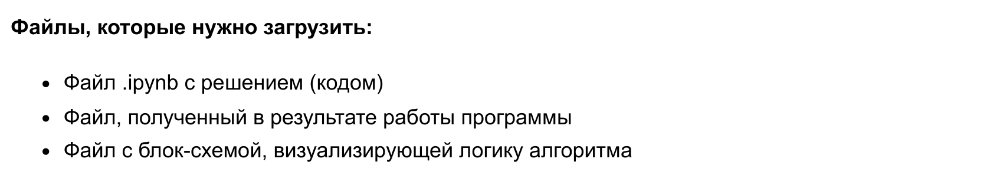

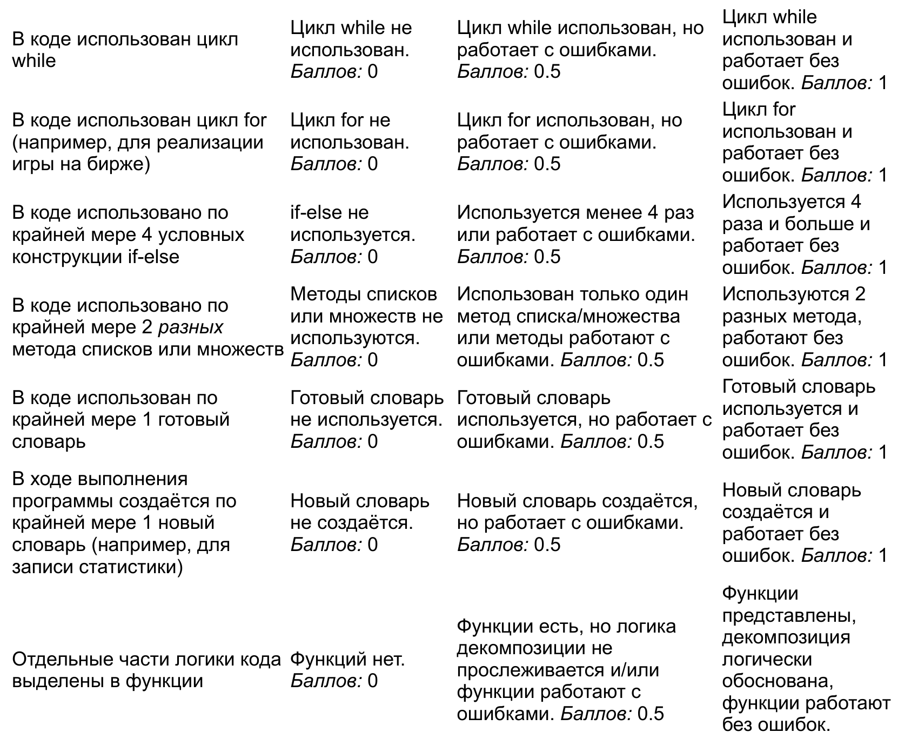

</details>
